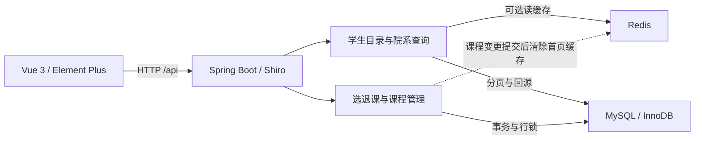

# 高校课程管理系统

面向学生、教师和管理员的高校课程管理系统，覆盖课程发布与审核、学生选课与退课、成绩录入与导出。学生可按名称、院系和学分筛选已审核且启用的课程，课程列表由服务端分页。

## 技术栈

| 层级 | 技术 | 项目中的用途 |
| --- | --- | --- |
| 前端 | Vue 3、Element Plus、Vue Router 4、Axios、Vite 5.4.21 | 页面组件、路由、接口请求和构建 |
| 后端 | Java 17、Spring Boot 2.7.14、Apache Shiro 1.10.1 | REST API、会话认证与角色授权 |
| 数据访问 | MyBatis Spring Boot Starter 2.3.1、Druid 1.2.18 | SQL 映射和数据库连接池 |
| 数据库 | MySQL 8.0（InnoDB） | 持久化课程和选课记录，通过事务与行锁保证名额一致性 |
| **缓存** | **Redis**、Spring Data Redis、Lettuce | 缓存学生端院系字典和可选课程首页。默认关闭，启用方式见 [Redis 缓存](#redis-缓存) |
| 监控与导出 | Spring Boot Actuator、Micrometer、Apache POI 5.2.3 | 请求、限流和缓存指标，以及 Excel 成绩导出 |

## 🎯 系统功能

### 1. 用户认证与权限管理
- **多角色登录**：学生、教师、管理员
- **基于Shiro的RBAC权限控制**：菜单级、按钮级权限控制
- **认证会话**：Shiro 会话空闲 30 分钟过期，刷新受保护页面时恢复当前登录用户和角色

### 2. 课程管理
- **课程发布**：教师可发布新课程
- **课程审核**：管理员审核课程，审核通过后学生方可选课
- **课程状态**：管理员可启用或停用课程
- **课程容量**：编辑课程时可调整容量，降容下限为实时已选人数
- **课程查询**：学生可按名称、院系和学分筛选，列表按查询条件在服务端分页

### 3. 选课管理
- **身份归属**：后端从当前登录会话关联学生身份，不信任客户端传入的 `studentId`
- **容量一致性**：以数据库条件更新原子占座，退课软取消并在同一事务内释放名额
- **并发保护**：选课和退课先锁定当前学生记录，再检查选课状态和课表。学生读写流量分别限流
- **冲突检测**：按周次、单双周、星期和节次判定冲突
- **退课功能**：学生只能退选自己的课程，历史记录保留为“已取消”
- **选课记录**：查看个人选课历史

### 4. 成绩管理
- **成绩录入**：教师录入平时成绩、期末成绩
- **自动计算**：总评成绩自动计算（当前规则为平时 30% + 期末 70%）
- **成绩管理**：修改、删除成绩记录
- **成绩导出**：Excel格式导出成绩单

## 🛠️ 技术架构

前端通过 `/api` 调用 Spring Boot 接口，由 Shiro 校验会话和角色。学生目录读取可先查 Redis，缓存未命中或 Redis 暂时不可用时，在并发预算内查 MySQL。选退课和容量变更直接在 MySQL 中执行，课程管理事务提交后清除首页缓存。



## 📁 项目结构

```
schoolsystem/
├── src/main/java/com/school/system/     # 后端Java代码
│   ├── common/                          # 通用类
│   │   ├── Result.java                  # 统一响应格式
│   │   └── PageResult.java              # 分页响应格式
│   ├── config/                          # 配置类
│   │   ├── ShiroConfig.java             # Shiro安全配置
│   │   └── GlobalExceptionHandler.java  # 全局异常处理
│   ├── controller/                      # 控制器层
│   │   ├── AuthController.java          # 认证相关接口
│   │   ├── CourseController.java        # 课程管理接口
│   │   ├── CourseSelectionController.java # 选课管理接口
│   │   ├── ScoreController.java         # 成绩管理接口
│   │   └── ExportController.java        # 导出接口
│   ├── dto/                             # 数据传输对象
│   │   ├── LoginDTO.java                # 登录DTO
│   │   ├── RegisterDTO.java             # 注册DTO
│   │   ├── CourseDTO.java               # 课程DTO
│   │   ├── CourseSelectionDTO.java      # 选课DTO
│   │   └── ScoreDTO.java                # 成绩DTO
│   ├── entity/                          # 实体类
│   │   ├── SysUser.java                 # 用户实体
│   │   ├── Course.java                  # 课程实体
│   │   ├── CourseSelection.java         # 选课记录实体
│   │   └── Score.java                   # 成绩实体
│   ├── mapper/                          # MyBatis Mapper接口
│   │   ├── CourseMapper.java            # 课程Mapper
│   │   ├── CourseSelectionMapper.java   # 选课Mapper
│   │   └── ScoreMapper.java             # 成绩Mapper
│   ├── service/                         # 服务层
│   │   ├── StudentCatalogService.java   # 学生目录分页与院系查询
│   │   ├── StudentCatalogCache.java     # Redis 读缓存与事务提交后失效
│   │   ├── StudentTrafficLimits.java    # 学生请求的读写并发和速率预算
│   │   ├── CourseService.java           # 课程服务
│   │   ├── CourseSelectionService.java  # 选课服务
│   │   ├── ScoreService.java            # 成绩服务
│   │   └── impl/                        # 服务实现
│   │       ├── CourseServiceImpl.java   # 课程服务实现
│   │       ├── CourseSelectionServiceV2.java # 当前选退课服务实现
│   │       └── ScoreServiceImpl.java    # 成绩服务实现
│   └── SchoolSystemApplication.java     # 启动类
├── src/main/resources/                  # 资源文件
│   ├── mapper/                          # MyBatis XML映射
│   │   ├── CourseMapper.xml             # 课程SQL映射
│   │   ├── CourseSelectionMapper.xml    # 选课SQL映射
│   │   └── ScoreMapper.xml              # 成绩SQL映射
│   └── application.yml                  # 应用配置
├── docs/course-selection-redis-upgrade.md # 升级方案、启用步骤与验收记录
├── -- 创建数据库.sql                     # 数据库初始化脚本
├── frontend/                            # 前端项目
│   ├── src/
│   │   ├── views/                       # 页面组件
│   │   │   ├── Home.vue                 # 主页面
│   │   │   ├── Login.vue                # 登录页
│   │   │   ├── course/                  # 课程管理页面
│   │   │   │   ├── CourseList.vue       # 课程列表
│   │   │   │   ├── AddCourse.vue        # 添加课程
│   │   │   │   ├── EditCourse.vue       # 编辑课程
│   │   │   │   └── CourseAudit.vue      # 课程审核（新增）
│   │   │   ├── selection/               # 选课管理页面
│   │   │   │   ├── SelectionList.vue    # 选课记录
│   │   │   │   └── SelectCourse.vue     # 选课中心
│   │   │   └── score/                   # 成绩管理页面
│   │   │       ├── ScoreList.vue        # 成绩列表
│   │   │       ├── AddScore.vue         # 添加成绩
│   │   │       └── EditScore.vue        # 编辑成绩
│   │   ├── router/                      # 路由配置
│   │   ├── api/                         # API接口
│   │   └── store/                       # 状态管理
│   └── package.json                     # 前端依赖配置
└── pom.xml                              # Maven配置
```

## 🚀 快速开始

### 1. 环境要求
- JDK 17+
- Maven 3.6+
- MySQL 8.0（集成测试使用 8.0.22）
- Node.js 20+
- npm 8+
- Redis（启用缓存时需要，集成测试使用 7.4.2）

### 2. 数据库初始化

在本地测试 MySQL 实例中执行项目根目录的 [数据库初始化脚本](./--%20创建数据库.sql)。脚本会创建 `school_system` 数据库、数据表、示例排课数据与演示账号。

### 3. 后端启动

在仓库根目录运行以下命令。先设置 `DB_URL`、`DB_USERNAME` 和 `DB_PASSWORD`。也可以将 [本地配置示例](src/main/resources/application-local.yml.example) 复制为同目录下的 `application-local.yml`，填写后以 `mvn spring-boot:run -Dspring-boot.run.profiles=local` 启动。

```bash
# 运行测试
mvn test

# 启动后端服务
mvn spring-boot:run
```

后端 API 默认位于 `http://localhost:8080/api`。

### 4. 前端启动

```bash
# 从仓库根目录进入前端目录
cd frontend

# 安装依赖
npm ci

# 启动前端开发服务器
npm run dev
```

前端开发页面默认位于 `http://localhost:3000`。

## 🔐 本地演示账号

| 角色 | 用户名 | 密码 | 权限说明 |
|------|--------|------|----------|
| 管理员 | admin | admin | 课程审核、上下架和课程管理 |
| 教师 | teacher | 123456 | 课程管理、成绩管理 |
| 学生 | student | 123456 | 选课、查看成绩 |

## 📊 核心业务流程

### 课程发布与审核流程
1. **教师发布课程**：教师登录系统，添加新课程
2. **自动进入审核**：教师提交的课程状态为"待审核"
3. **管理员审核**：管理员在课程审核页面查看待审核课程
4. **审核结果**：管理员通过或拒绝课程申请
5. **学生选课**：可选目录仅显示已通过审核且启用的课程

### 成绩管理流程
1. **教师录入成绩**：录入平时成绩和期末成绩
2. **自动计算总评**：系统按权重自动计算总评成绩
3. **成绩修改**：教师可修改已录入的成绩
4. **成绩导出**：支持Excel格式导出

## 🔧 关键配置

### 数据库配置
```yaml
spring:
  datasource:
    url: ${DB_URL:...}
    username: ${DB_USERNAME:root}
    password: ${DB_PASSWORD:}
```

`application.yml` 不含数据库密码。Druid 监控页默认关闭；若在受控内网启用，必须同时设置强凭据和网络访问边界。

### Redis 缓存

设置 `CACHE_ENABLED=true` 启用院系字典缓存。再设置 `CACHE_SELECTABLE_HOME_ENABLED=true`，可缓存每页 10 条、无筛选的第一页。通过 `REDIS_HOST`、`REDIS_PORT`、`REDIS_USERNAME` 和 `REDIS_PASSWORD` 配置连接。回退、故障复测和本地压测记录见 [选课系统升级方案](docs/course-selection-redis-upgrade.md#7-启用与复测)。

### Shiro权限配置
- **匿名访问**：登录、注册页面
- **学生权限**：选课、查看成绩
- **教师权限**：课程管理、成绩管理
- **管理员权限**：所有权限，包括课程审核

## 🎨 界面特色

### 响应式设计
- 支持PC端和移动端访问
- Element Plus组件库，界面美观统一

### 用户体验优化
- 侧边栏二级菜单深色背景，文字清晰可读
- 操作反馈及时，错误提示明确
- 数据加载状态提示

## 📈 性能特性

### 后端可靠性
- **原子容量控制**：`selected_count < capacity` 是数据库更新条件，避免并发超卖
- **数据约束**：课程容量、选课人数、成绩范围和排课时间均有数据库约束
- **稳定分页**：可选课程按 `create_time DESC, course_id DESC` 排序，选课记录按 `create_time DESC, selection_id DESC` 排序
- **缓存降级**：热门缓存使用带租约的回源锁和带抖动的 TTL，Redis 连续失败时短暂熔断并限制 MySQL 回源并发
- **链路定位**：每个响应返回 `X-Trace-Id`，日志也携带该值

### 前端性能
- **构建优化**：Vite快速构建
- **代码分割**：按需加载组件
- **资源压缩**：生产环境自动压缩

## 🐛 故障排除

### 常见问题

1. **数据库连接失败**
   - 检查MySQL服务是否启动
   - 确认数据库配置正确

2. **权限问题**
   - 确认用户角色配置
   - 检查Shiro过滤器配置

3. **前端编译错误**
   - 清除node_modules重新安装依赖
   - 检查Node.js版本兼容性

### 日志查看
- 后端日志：控制台输出或logs目录
- 前端日志：浏览器开发者工具

## 📞 技术支持

如有问题请联系系统管理员或查看项目文档。

---

构建版本见 [pom.xml](pom.xml)。生产库对账和多实例峰值压测仍待目标环境验收。
